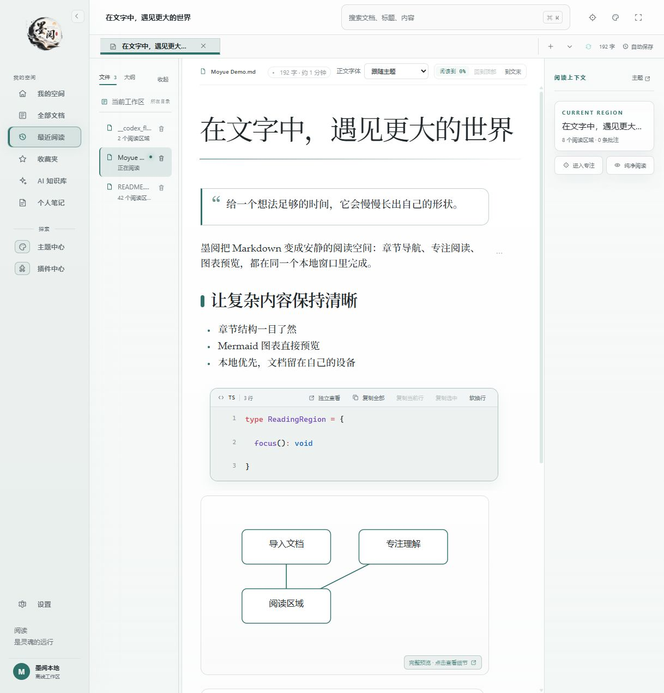
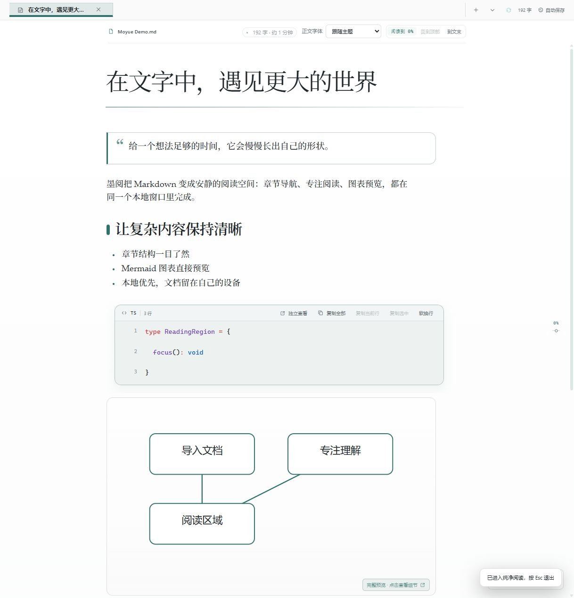
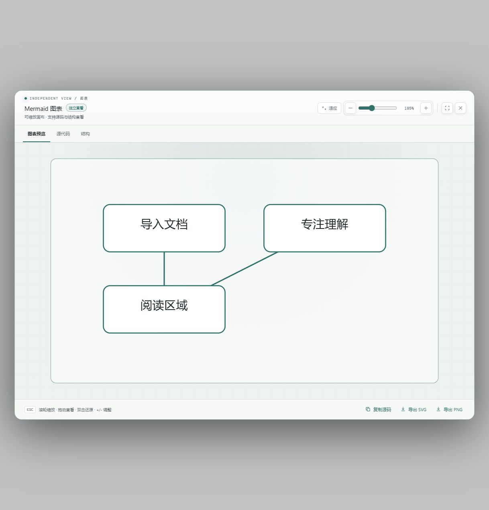

<p align="center">
  
</p>

<h1 align="center">墨阅 · Moyue Reader</h1>

<p align="center"><strong>长文慢慢读，灵感随手写，答案回到原文。</strong></p>
<p align="center">为技术文档、读书笔记和本地资料打造的 Markdown 桌面工作台。<br>打开一个文件夹，就能在同一处阅读、写作和查找资料。</p>

<p align="center">
  <a href="#快速上手"><strong>快速上手</strong></a> ·
  <a href="#功能亮点">功能亮点</a> ·
  <a href="#本地知识库">本地知识库</a> ·
  <a href="#桌面打包">桌面打包</a>
</p>

<p align="center">
  
  <br><sub>墨阅运行界面 · 示例文档</sub>
</p>

## 功能亮点

| 你想做什么 | 在墨阅里怎么做 |
| --- | --- |
| **读完一篇很长的文档** | 从大纲跳到章节，按 `F` 进入专注模式。划词高亮、写批注，下次打开从上次的位置继续。 |
| **边读边改一份笔记** | 在所见即所得、源码和分栏预览间切换，共用同一份 Markdown 和撤销历史。表格可以直接编辑，公式和脚注在正文里即可查看。 |
| **看懂技术文档里的代码和图** | Shiki 为代码高亮并显示行号。Mermaid 图表可以单独打开、缩放、拖动和导出为 SVG 或 PNG。章节还能切换成思维导图。 |
| **从一整个文件夹里找原话** | 用全局搜索查关键词，或在知识库里选定几篇资料再提问。点击引用即可跳回对应段落。 |

<p align="center">
  
  
  <br><sub>专注阅读 · Mermaid 图表查看器</sub>
</p>

- **本地优先。** 阅读、写作和关键词检索可以离线使用，无需账号。桌面端会保留阅读进度与批注，支持加载相对路径图片，并监听已打开文件的外部修改。
- **按你的习惯读写。** 「静默苔原」「纯净白纸」「烟雨竹影」等内置主题可直接切换，也能自定义主题、导入或导出主题包。写作时可开启打字机模式，草稿恢复和磁盘冲突保护会帮你保住修改。
- **写完就能分享。** 支持 HTML、DOCX、EPUB、LaTeX、PNG 长图和 PDF 等格式。桌面端导出 DOCX 或 LaTeX 需要 Pandoc，DOCX 支持自定义 Word 模板。详见 [写作与导出验收记录](./docs/typora-gap-verification.md)。

## 快速上手

### 浏览器预览

用 Node.js 22.12+（推荐 22 或 24 LTS）运行以下命令。启动后打开 Vite 输出的本地地址，体验基础 Markdown 渲染和写作界面。

```bash
git clone https://github.com/lxyhes/md-read.git
cd md-read
npm ci
npm run dev
```

### 桌面版

按上面的步骤克隆仓库并执行 `npm ci`，再准备 Rust stable 和对应平台的系统依赖。桌面版提供文件夹扫描、外部文件监听、相对图片加载和 SQLite 持久化。 [Tauri 环境准备](https://v2.tauri.app/start/prerequisites/)

```bash
npm run tauri dev
```

启动后，在应用里点击「导入 Markdown」、打开文件夹，或把 Markdown 文件拖进窗口。安装 Windows 或 macOS 桌面包后，也可通过系统的「打开方式」将 `.md`、`.markdown` 和 `.qmd` 文件交给墨阅，已运行的应用会在新标签中打开文件。

## 本地知识库

把要用的文档加入「本次资料」，试着问「这几份笔记怎么解释这个概念？」墨阅会检索选定范围内的原文，点一下引用就能回到对应段落。

- **离线检索。** 关键词检索开箱即用。桌面端可在「设置 → 阅读偏好 → AI 能力」开启本地语义检索。先运行 `ollama pull qwen3-embedding:0.6b` 安装模型，再选定资料，墨阅会在本机后台建索引。模型暂时不可用时会回退到关键词检索。
- **可选 AI 问答。** 同一设置页可连接本地 Ollama 或 OpenAI-compatible 服务。开启 AI 问答后，墨阅会将本轮检索到的片段及相关上下文发送给所选模型，并在回答中提供可核对的原文引用。API Key 仅保留在当前会话。
- **实时语音。** 桌面端配置 OpenAI 官方接口及 API Key 后，可使用实时字幕、静音和开口打断。通话会将麦克风音频和本轮检索到的原文发送给 OpenAI Realtime。

[查看知识库检索设计](./docs/knowledge-base-design.md)

## 常用快捷键

| 快捷键 | 操作 |
| --- | --- |
| `Ctrl / Cmd + K` | 搜索全部文档 |
| `Ctrl / Cmd + F` | 搜索当前文档 |
| `Ctrl / Cmd + O` | 打开 Markdown 文件 |
| `Ctrl / Cmd + Tab` | 切换到下一个文档标签 |
| `F` | 进入或退出专注模式 |
| `↑` / `↓` | 在专注模式中切换阅读区域 |
| `Enter` / `Space` | 在专注模式中聚焦当前区域 |
| `Esc` | 退出聚焦或关闭查看器 |

## 桌面打包

墨阅处于桌面端 V1 开发阶段，可在本机生成安装包。Windows 和 macOS 需在对应系统上打包。

| 平台 | 命令 | 产物 |
| --- | --- | --- |
| Windows | `npm run package:windows` | NSIS `.exe` |
| macOS | `npm run package:macos` | `.app`、`.dmg` |
| Linux / WSL | `npm run package:linux` | `.deb`、AppImage |

默认输出目录为 `src-tauri/target/release/bundle/`。也可使用项目根目录的一键打包脚本。推送 `v*` 标签或手动运行工作流，可生成 Windows 和 macOS 的 GitHub Actions 构建产物。 [Build desktop packages 工作流](https://github.com/lxyhes/md-read/actions/workflows/build-desktop.yml)

<details>
<summary>Linux 打包与安装</summary>

在 Ubuntu / Debian 上准备 Node.js 22.12+、Rust stable 和系统依赖。

```bash
sudo apt update
sudo apt install build-essential pkg-config curl wget file libwebkit2gtk-4.1-dev libxdo-dev libssl-dev libayatana-appindicator3-dev librsvg2-dev
bash ./一键打包桌面端.sh
```

在 Windows 上也可以启用 Docker Desktop 的 Linux 容器引擎，双击 `一键打包Linux桌面端.bat` 构建 Linux x86-64 安装包。

进入产物目录后，可用 `sudo apt install ./文件名.deb` 安装 Debian 包，或对 AppImage 运行 `chmod +x ./文件名.AppImage` 后直接执行。需要兼容多个发行版时，在目标范围内最老且提供 WebKitGTK 4.1 的系统上构建。 [AppImage 兼容性说明](https://v2.tauri.app/distribute/appimage/#limitations)

</details>

## 开发与反馈

墨阅使用 Vue 3、TypeScript、Vite 和 Pinia 构建界面，Tauri 2 与 Rust 提供桌面能力，SQLite 保存本地状态。Markdown 由 remark / unified 解析，编辑器基于 CodeMirror 6，公式由 MathJax 渲染。

```bash
npm run test      # 运行测试
npm run build     # 类型检查与前端构建
npm run preview   # 预览前端生产构建
```

<details>
<summary>运行知识库检索评测</summary>

安装语义模型并启动 Ollama 后，运行以下命令，比较关键词检索与混合检索在段落级题目上的表现。

```bash
MOYUE_EVAL_OLLAMA=1 npm run test -- src/knowledgeSearch.evaluation.test.ts
```

PowerShell 中先运行 `$env:MOYUE_EVAL_OLLAMA = '1'`，再执行 `npm run test -- src/knowledgeSearch.evaluation.test.ts`。

</details>

欢迎用自己的 Markdown 文档试一遍。遇到问题时，欢迎附上复现步骤、系统信息和一小段脱敏示例。 [提交 Issue](https://github.com/lxyhes/md-read/issues)

## 许可证

许可证与发布方式待确定。
